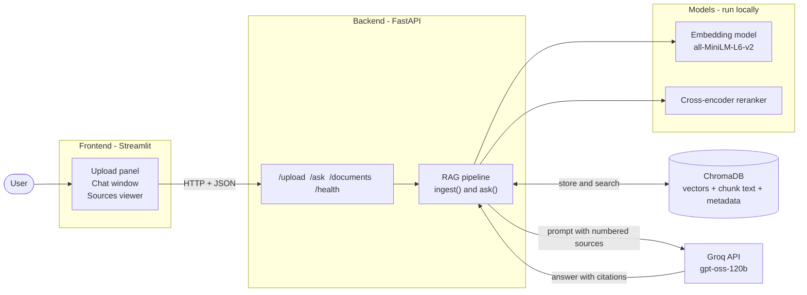
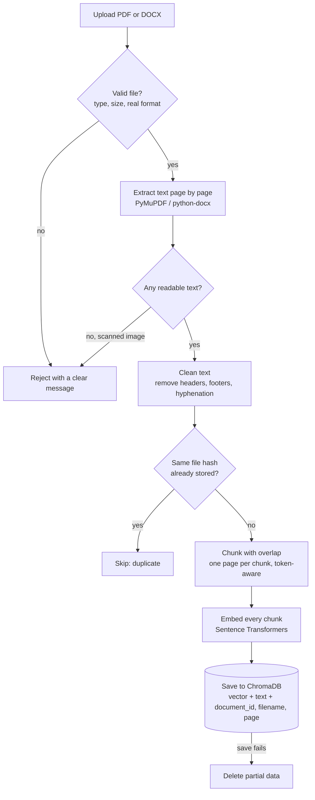
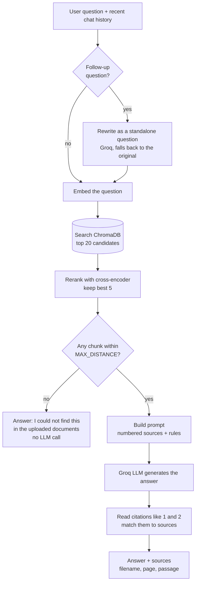

# Chat With Your Documents: a RAG Application Built From Scratch


Upload PDF or Word documents, ask questions in plain language, and get answers that come **only from your documents**. Every answer comes with numbered citations and the exact passages it was based on. If the documents don't contain the answer, the app says so instead of guessing.

I built this step by step, **without LangChain**, to understand every part of a Retrieval-Augmented Generation (RAG) system: extraction, chunking, embeddings, vector search, reranking, prompting, citations and evaluation.

<!-- << Add a screenshot of the chat with the Sources box open:
 -->

---

## Why RAG?

A language model doesn't know what is in your private documents, and it can give confident answers that aren't supported by anything. RAG fixes this: the app first **retrieves** the relevant passages from your documents, then gives them to the model as context. The model's weights never change. It only sees better input.

---

## Features

**Documents**
- Upload PDF and DOCX files with safety checks: allowed type, size limit, real file format (not just the extension) and cleaned filenames
- Duplicate detection by content hash, so a renamed copy is still caught
- List documents, and delete one together with all of its stored chunks

**Question answering**
- Answers grounded in retrieved passages, with numbered citations
- A sources panel showing filename, page, match score and the exact passage, with the cited ones marked
- Follow-up questions ("explain that more simply") through question rewriting
- Refuses to answer when nothing relevant is found (without calling the LLM)
- Search all documents, or only one

**Retrieval**
- Vector search, hybrid search (meaning + keywords), and cross-encoder reranking
- Settings for chunk size, overlap, number of results and distance threshold

**Quality**
- Automated tests with pytest, using fake models so they run fast and offline
- An evaluation toolkit measuring `Hit@5` and MRR, plus answer-level checks

---

## Architecture

### System overview



ChromaDB is the **shared memory** of the app: uploading writes to it, and answering reads from it. The embedding model and reranker run on your own machine. Only the final prompt (the question plus the selected passages) is sent to Groq.

### Flow 1: uploading a document



The original file is **not kept**. It is processed in a temporary folder and deleted. Only the chunks and their metadata are stored.

### Flow 2: asking a question



### Key design points
- **Metadata travels with every chunk**: `document_id`, `filename`, `page_number` and `chunk_index` are attached at extraction and stay attached through chunking, storage, retrieval and the final citation.
- **Two layers of "I don't know"**: if no chunk is close enough, the app refuses without calling the LLM. If chunks exist but don't contain the answer, the prompt rules make the model refuse.
- **Defensive by design**: if rewriting a follow-up fails, the original question is used. If saving a document fails halfway, the partial data is removed. Text in documents is treated as information, never as instructions (a basic prompt-injection defense).

---

## Tech Stack

| Layer | Technology | Why it is used |
|---|---|---|
| **Language** | Python 3.11 | Core language |
| **Backend** | FastAPI + Uvicorn | REST API with automatic validation and a built-in `/docs` page |
| | Pydantic | Request and response schemas |
| **Frontend** | Streamlit | Quick chat UI with file upload, written in Python |
| | requests | The frontend's HTTP client |
| **Extraction** | PyMuPDF | PDF text extraction with page numbers |
| | python-docx | DOCX paragraphs and tables |
| **Embeddings** | Sentence Transformers | Loads embedding and reranking models |
| | `all-MiniLM-L6-v2` | Small, fast, 384-dimension embeddings that run on CPU |
| **Vector store** | ChromaDB | Stores vectors, text and metadata, with similarity search and filtering |
| **Retrieval** | Cross-encoder reranker | Re-scores the top candidates for better ordering |
| | rank-bm25 | Keyword search for the optional hybrid mode |
| **LLM** | Groq API (`openai/gpt-oss-120b`) | Answer generation and follow-up rewriting |
| **Config** | python-dotenv | Keeps the API key out of the code |
| **Testing** | pytest + httpx | Unit and API tests |

---

## Project Structure

```
rag-app/
├── data/
│   ├── raw/                   # your own test documents (git-ignored)
│   └── chroma_db/             # persistent vector database (git-ignored)
├── evaluation/
│   ├── draft_questions.py     # drafts test questions from your document
│   ├── run_eval.py            # retrieval evaluation (Hit@5, MRR, thresholds)
│   ├── run_answers.py         # end-to-end answer checks
│   ├── show_pages.py          # shows extracted text, to copy evidence phrases
│   └── test_set.json          # template for your own questions
├── experiments/               # small scripts written while learning each step
├── frontend/
│   ├── app.py                 # Streamlit app
│   └── api_client.py          # HTTP calls to the backend
├── src/
│   ├── api/                   # FastAPI routes and schemas
│   ├── embeddings/            # embedding model wrapper
│   ├── extraction/            # file validation, PDF and DOCX extraction
│   ├── llm/                   # Groq client, prompts, citation parsing
│   ├── pipeline/              # ingest() and ask()
│   ├── processing/            # cleaning and chunking
│   ├── retrieval/             # vector, hybrid and reranking search
│   ├── vectorstore/           # ChromaDB storage, duplicates, deletion
│   └── config.py              # all settings
├── tests/                     # automated tests
├── .env.example               # template for your API key
├── .gitignore
├── requirements.txt
└── README.md
```

---

## Setup

**Prerequisites:** Python 3.11, Git, and a [Groq API key](https://console.groq.com).

```bash
git clone https://github.com/<your-username>/<your-repo>.git
cd <your-repo>
python -m venv .venv
```

Activate the environment:
```bash
# Windows PowerShell
.venv\Scripts\Activate.ps1

# macOS / Linux
source .venv/bin/activate
```

Install and configure:
```bash
pip install -r requirements.txt
```
Copy `.env.example` to `.env` and add your key:
```
GROQ_API_KEY=your_key_here
```
Never commit your real `.env` file.

The first run downloads the embedding and reranking models (a few hundred MB in total), so it takes longer.

## Run

The app has two processes. Use two terminals, with the environment activated in both.

**Backend**
```bash
python -m uvicorn src.api.main:app --port 8000
```
API docs: http://127.0.0.1:8000/docs

**Frontend**
```bash
python -m streamlit run frontend/app.py
```
Open http://localhost:8501.

---

## API

| Method | Endpoint | Description |
|---|---|---|
| GET | `/health` | Server status and total chunk count |
| POST | `/upload` | Upload and index a PDF or DOCX |
| POST | `/ask` | Ask a question (supports chat history and a document filter) |
| GET | `/documents` | List stored documents |
| DELETE | `/documents/{document_id}` | Delete a document and all its chunks |

---

## Configuration

All settings live in `src/config.py`.

| Setting | Meaning | Current |
|---|---|---|
| `EMBEDDING_MODEL_NAME` | Embedding model | `all-MiniLM-L6-v2` |
| `CHUNK_MAX_TOKENS` / `CHUNK_OVERLAP_TOKENS` | Chunk size and overlap | `200` / `40` |
| `TOP_K` | Chunks given to the LLM | `5` |
| `MAX_DISTANCE` | Chunks farther than this are treated as not relevant | `0.75` |
| `RETRIEVAL_MODE` | `vector`, `hybrid`, `vector+rerank`, `hybrid+rerank` | `vector+rerank` |
| `GROQ_MODEL` | Model for answers | `openai/gpt-oss-120b` |

**Re-upload after changes.** If you change the embedding model or the chunk settings, delete and re-upload your documents. Each embedding model uses its own collection, and `MAX_DISTANCE` must be tuned again for every model, because different models use different distance scales.

---

## Testing

```bash
python -m pytest -q
```
The tests use fake embedding and LLM objects, so they run in seconds, offline, and never touch your real database. They cover chunking, cleaning, file validation, duplicate detection, deletion, retrieval, reranking, citations, follow-up rewriting, and the API (including bad uploads and invalid input).

Result of my last run: `<< paste the line your own run prints, for example "89 passed" >>`

---

## Evaluation

I measured retrieval and answers instead of choosing settings by feel.

**Metrics**
- `Hit@5`: the percentage of answerable questions where the right passage appears in the top 5 results.
- `MRR` (Mean Reciprocal Rank): how high the right passage ranks on average. 1.0 means always first.

### Evaluate it on your own documents
The evaluation needs your own document, because I haven't included my course notes.

```bash
# 1. Put a PDF in data/raw/, then look at the text the app extracts
python -m evaluation.show_pages data/raw/yourfile.pdf

# 2. Draft test questions with the LLM (review every one by hand!)
python -m evaluation.draft_questions --doc data/raw/yourfile.pdf --count 15

# 3. Compare retrieval settings
python -m evaluation.run_eval --test-set evaluation/draft_test_set.json --configs "150:30,200:40" --modes vector,hybrid,vector+rerank,hybrid+rerank

# 4. Check real end-to-end answers
python -m evaluation.run_answers --test-set evaluation/draft_test_set.json
```
Add a few "near-miss" unanswerable questions by hand, meaning questions related to your topic that the document does NOT answer. They test refusal best.

### My results
Tested on one set of course notes about Git and version control (about 80 chunks). <!-- << Check every number below against your latest run_eval and run_answers output -->

| Metric (chunk size 200, overlap 40) | Vector | Vector + rerank |
|---|---|---|
| `Hit@5` | 71% | **86%** |
| `MRR` | 0.65 | **0.72** |

Answer check on 14 answerable and 3 unanswerable questions: all 14 answerable questions got an answer that cites a source and contains an expected keyword, and all 3 unanswerable questions were refused. This checks the app's behaviour. It does not prove that every answer is factually correct.

### What I learned
- **Reranking was the only change that clearly helped.** Before it, the right passage was often retrieved but not ranked first.
- **Hybrid search added nothing here.** With only about 80 chunks, the vector search's top 20 already covers a quarter of the document. Hybrid should matter more with many documents and exact names or codes.
- **Bigger embedding models were not clearly better.** `bge-small` and `all-mpnet-base-v2` did not beat `all-MiniLM-L6-v2` consistently on these notes.
- **Every embedding model needs its own `MAX_DISTANCE`.** The best threshold for `bge-small` was far lower than for MiniLM.
- **Some "misses" were bad test questions**, not retrieval failures. Reviewing the drafted questions matters.
- **Cleaning matters.** A repeated page header was ending up inside chunks until the cleaner was improved.

**Caveat:** the test set is small (one document, 14 to 15 questions, and one question is about 7 percentage points). Treat these results as evidence for my choices on these notes, not as a general benchmark.

---

## Limitations
- English only (the embedding and reranking models are English-trained)
- Scanned PDFs are rejected (there is no OCR yet)
- DOCX files have no page numbers, so their citations show only the filename
- No user accounts: all users share one document collection
- Tables and images are not handled specially
- Answers can still be wrong, so check the cited passages for anything important

## Troubleshooting
- **"Cannot reach the backend"**: start the FastAPI server first, then refresh the Streamlit page.
- **`No module named ...`**: the virtual environment isn't active. The prompt should start with `(.venv)`.
- **Groq errors**: `401`/`403` means a wrong key, `429` means a rate limit (wait a minute), and `5xx` means a provider problem. The real reason is in the backend terminal.
- **Answers got worse after changing settings**: delete and re-upload your documents.

## Future improvements
- OCR for scanned PDFs
- User accounts and per-user document collections
- Better handling of tables and images
- Streaming answers
- Docker and cloud deployment
- Evaluation on larger and more varied document sets

## License
<< Add a LICENSE file (for example MIT) and name it here. >>

## Author
<< Your name >>: [GitHub](https://github.com/<your-username>)
